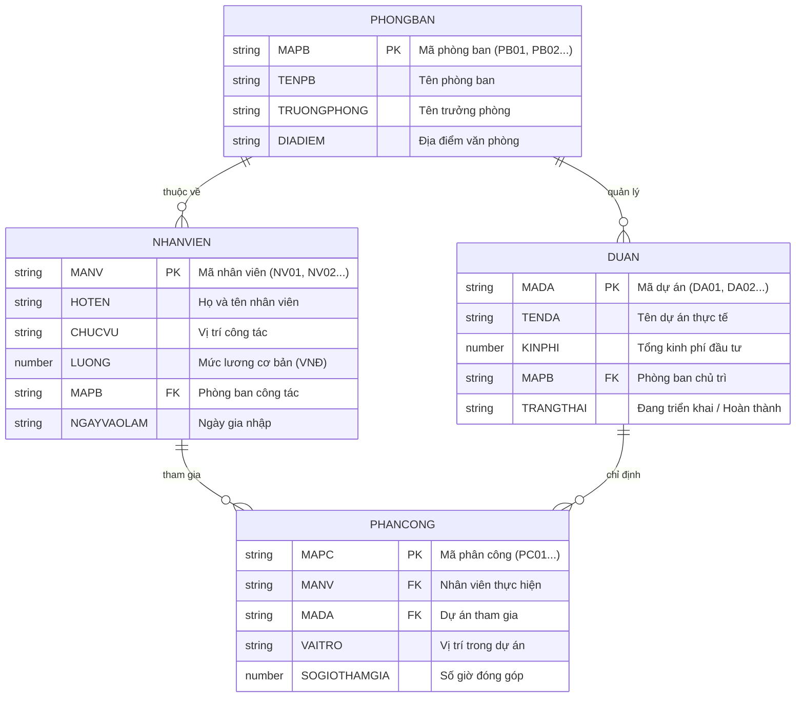

# 🚀 SQLFlow 2.0 - Nền Tảng Học & Thực Hành SQL Trực Quan

> **Học & Thực hành SQL thuần trình duyệt với hiệu năng 120 FPS, mô phỏng CSDL 3D Isometric, Autocomplete thông minh chuẩn IntelliJ, sơ đồ ERD quan hệ bảng trực quan và hệ thống phân quyền quản trị bảo trì theo từng trang.**

---

## 📋 Mục Lục
1. [Giới thiệu dự án](#-giới-thiệu-dự-án)
2. [Yêu cầu hệ thống (Nên cài gì trước?)](#-yêu-cầu-hệ-thống)
3. [Hướng dẫn cài đặt & Khởi chạy code](#-hướng-dẫn-cài-đặt--khởi-chạy-code)
4. [Hai chế độ sử dụng chính](#-hai-chế-độ-sử-dụng-chính)
5. [Cơ sở dữ liệu mẫu 4 bảng Tiếng Việt](#-cơ-sở-dữ-liệu-mẫu-4-bảng-tiếng-việt)
6. [Hệ thống Quản lý Bảo trì Từng Trang (Dành cho Admin)](#-hệ-thống-quản-lý-bảo-trì-từng-trang)
7. [Cơ chế Đồng bộ Lịch sử Duyệt Web 2 Chiều](#-cơ-chế-đồng-bộ-lịch-sử-duyệt-web-2-chiều)
8. [Cấu trúc mã nguồn & Giải thích Component](#-cấu-trúc-mã-nguồn--giải-thích-component)
9. [Bảng phím tắt trong SQL IDE](#-bảng-phím-tắt-trong-sql-ide)
10. [Các câu lệnh Script hữu ích](#-các-câu-lệnh-script-hữu-ích)
11. [Xử lý lỗi thường gặp (Troubleshooting)](#-xử-lý-lỗi-thường-gặp)

---

## 🌟 Giới Thiệu Dự Án

**SQLFlow** là nền tảng Web hiện đại giúp người mới bắt đầu và lập trình viên học tập, thực hành truy vấn SQL trực quan mà không cần cài đặt phần mềm CSDL nặng nề (như PostgreSQL, MySQL hay DBeaver):
- **Bộ máy thực thi SQL In-Memory độc lập**: Chạy 100% trong trình duyệt (Zero-Latency, không tốn tài nguyên máy chủ).
- **Trình soạn thảo SQL phong cách macOS Chrome**: Hỗ trợ Syntax Highlighting thời gian thực, line numbers, tự động định dạng mã nguồn (Format SQL), thụt lề thông minh và gợi ý Autocomplete chuẩn IntelliJ.
- **Sơ đồ ERD & Lược đồ CSDL thời gian thực**: Tự động phát hiện quan hệ Khóa chính (PK) và Khóa ngoại (FK), hiển thị các đường liên kết trực quan.
- **Phân tích kế hoạch thực thi EXPLAIN**: Mô phỏng trực quan từng bước xử lý dữ liệu (Scan, Filter WHERE, Join match, Group By, Aggregate).
- **Hệ thống phân quyền & Bảo trì linh hoạt**: Super Admin có toàn quyền bật/tắt bảo trì độc lập cho từng trang (`#curriculum`, `#workspace/courses`, `#workspace/practice`, v.v.).

---

## 💻 Yêu Cầu Hệ Thống

Trước khi khởi chạy dự án, máy tính của bạn cần cài đặt các công cụ sau:

| Phần mềm / Công cụ | Phiên bản khuyến nghị | Mục đích sử dụng |
| :--- | :--- | :--- |
| **Node.js** | **v18.x** hoặc **v20.x trở lên** (LTS) | Môi trường runtime JavaScript để biên dịch mã nguồn |
| **npm** | Đi kèm Node.js (v9.x hoặc v10.x) | Trình quản lý thư viện / packages |
| **Trình duyệt Web** | Chrome, Edge, Safari hoặc Firefox | Hiển thị giao diện và chạy bộ máy SQL |
| **VS Code / Cursor** | Phiên bản mới nhất *(Khuyến nghị)* | Trình soạn thảo mã nguồn tối ưu |

> 💡 **Kiểm tra phiên bản Node.js hiện tại trên máy tính:**
> ```bash
> node -v
> npm -v
> ```
> *(Nếu chưa có Node.js, bạn có thể tải bản LTS miễn phí tại [https://nodejs.org](https://nodejs.org))*.

---

## 🛠️ Hướng Dẫn Cài Đặt & Khởi Chạy Code

Chỉ cần **3 bước đơn giản** trong cửa sổ Terminal:

### Bước 1: Mở thư mục dự án
```bash
cd /Users/phuocthinh/Documents/code/SQL
```

### Bước 2: Cài đặt các thư viện (Dependencies)
```bash
npm install
```
*(Quá trình này sẽ tự động cài đặt React 19, TypeScript, Vite, TailwindCSS, Lucide Icons về thư mục `node_modules`).*

### Bước 3: Khởi chạy môi trường phát triển (Development Server)
```bash
npm run dev
```

Sau khi chạy thành công, Terminal sẽ hiển thị:
```text
  VITE v6.4.4  ready in 250 ms

  ➜  Local:   http://localhost:5173/
  ➜  Network: use --host to expose
  ➜  press h + enter to show help
```

👉 Mở trình duyệt web và truy cập vào địa chỉ: **`http://localhost:5173`**

---

## 🎯 Hai Chế Độ Sử Dụng Chính

### 1. Nút `SQL` (SQL Playground độc lập)
* **Đối tượng**: Người dùng cần một môi trường IDE nhanh gọn để viết query tự do mà **không cần đăng nhập hay tạo tài khoản**.
* **Đặc điểm**:
  - Giao diện tối giản, tập trung vào khung soạn thảo SQL và kết quả bảng.
  - Sẵn sàng với **Cơ sở dữ liệu Công ty 4 bảng Tiếng Việt** có sẵn dữ liệu thực tế.

### 2. Nút `Học SQL` (Không gian học tập & Quản trị bài bản)
* **Đối tượng**: Học viên muốn học bài bản theo lộ trình và Quản trị viên quản lý nền tảng.
* **Đặc điểm**:
  - **Chế độ Học viên (Learner)**: Lộ trình khóa học, bài tập chấm điểm tự động, quản lý dự án cá nhân và hồ sơ tiến độ.
  - **Chế độ Quản trị viên (Super Admin)**: Bảng điều khiển quản lý học viên, quản lý khóa học, ma trận phân quyền RBAC và Trung tâm bật/tắt bảo trì hệ thống.

---

## 🏢 Cơ Sở Dữ Liệu Mẫu 4 Bảng Tiếng Việt

Môi trường SQL Playground được tích hợp sẵn 4 bảng dữ liệu Tiếng Việt viết hoa chuẩn mực, có sẵn các dòng dữ liệu mẫu và quan hệ Khóa chính / Khóa ngoại chặt chẽ:



💡 *Ví dụ câu lệnh truy vấn mẫu có thể thử ngay trên Playground:*
```sql
SELECT 
  nv.HOTEN, 
  nv.CHUCVU, 
  pb.TENPB, 
  da.TENDA, 
  pc.VAITRO, 
  pc.SOGIOTHAMGIA
FROM NHANVIEN nv
JOIN PHONGBAN pb ON nv.MAPB = pb.MAPB
JOIN PHANCONG pc ON nv.MANV = pc.MANV
JOIN DUAN da ON pc.MADA = da.MADA
ORDER BY pc.SOGIOTHAMGIA DESC;
```

---

## 🛡️ Hệ Thống Quản Lý Bảo Trì Từng Trang

Hệ thống cho phép Quản trị viên (Super Admin) toàn quyền kích hoạt hoặc gỡ bỏ lệnh bảo trì cho từng trang và tính năng cụ thể:

* **Vị trí bảng điều khiển**: 
  - Tại trang **Vai trò & Quyền** (`#workspace/admin-roles`).
  - Hoặc bấm nút **"Quản lý Bảo trì Trang"** trên đỉnh **Admin Dashboard** (`#workspace/admin-dashboard`).
* **Các trang được hỗ trợ công tắc bảo trì độc lập**:
  1. `curriculum`: Lộ trình học tập (`#curriculum` trên Trang chủ)
  2. `courses`: Danh mục khóa học (`#workspace/courses`)
  3. `practice`: Luyện tập & Chấm điểm tự động (`#workspace/practice`)
  4. `projects`: Quản lý dự án cá nhân (`#workspace/projects`)
  5. `workspace`: Toàn bộ không gian học tập tổng quan (`#workspace/overview`)
  6. `sqlPlayground`: Trình thực hành SQL tự do (`#sql`)
* **Tiện ích đi kèm**:
  - Công tắc **Toggle Switch** gạt On/Off tức thì chuẩn phong cách Apple.
  - 2 nút hành động nhanh: **"Bảo trì tất cả"** & **"Mở hoạt động tất cả (Gỡ lệnh)"**.
  - Lưu trạng thái bền vững vào `localStorage` (không bị mất khi tải lại trang).
  - Tự động ghi nhận mọi thao tác vào **Nhật ký hệ thống (Audit Logs)**.

---

## 🔄 Cơ Chế Đồng Bộ Lịch Sử Duyệt Web 2 Chiều

* **Vấn đề trước đây**: Khi bấm nút Back ($\leftarrow$) trên trình duyệt, URL trên thanh địa chỉ thay đổi nhưng giao diện SPA đứng yên vì React chỉ lưu view trong state nội bộ.
* **Giải pháp hiện tại**:
  - Chuẩn hóa URL Hash: `#landing`, `#sql`, `#workspace/<tab>` (ví dụ `#workspace/courses`, `#workspace/projects`...).
  - Đăng ký bộ lắng nghe sự kiện `popstate` và `hashchange`.
  - Khi người dùng bấm **Back** hoặc **Forward** trên trình duyệt, React tự động nhận diện URL mới và chuyển màn hình tương ứng tức thì.
  - Khi người dùng chuyển trang hoặc đổi tab trên giao diện, ứng dụng tự động gọi `window.history.pushState` để tạo mốc lịch sử duyệt web chuẩn mực.

---

## 📂 Cấu Trúc Mã Nguồn & Giải Thích Component

```text
src/
├── App.tsx                              # Root Component điều phối toàn bộ ứng dụng
├── main.tsx                             # Entry point khởi tạo React DOM
├── index.css                            # Tailwind CSS và cấu hình kiểu dáng toàn cục
│
├── config/                              # CẤU HÌNH HỆ THỐNG
│   └── maintenance.ts                   # Trình quản lý cấu hình bảo trì theo từng trang
│
├── services/                            # TẦNG DỊCH VỤ HƯỚNG ĐỐI TƯỢNG (OOP SERVICES)
│   ├── AuditService.ts                  # Quản lý nhật ký kiểm toán, lọc và thêm log
│   ├── ProjectService.ts                # Quản lý CRUD dự án cá nhân & các câu lệnh SQL
│   ├── StudentService.ts                # Quản lý học viên, khóa/mở tài khoản, hỗ trợ
│   └── MaintenanceService.ts            # Quản lý trạng thái bảo trì từng trang & localStorage
│
├── hooks/                               # CUSTOM HOOKS
│   └── useNavigation.ts                 # Quản lý đồng bộ 2 chiều URL Hash, History Back/Forward
│
├── modules/                             # CÁC PHÂN HỆ CHỨC NĂNG (MODULES)
│   ├── sql/
│   │   └── SqlPlaygroundModule.tsx      # Module Trình soạn thảo SQL Playground độc lập
│   └── workspace/
│       └── WorkspaceModule.tsx          # Module Không gian học tập & Quản trị hệ thống
│
├── engine/                              # BỘ MÁY CSDL IN-MEMORY
│   ├── initialDb.ts                     # Schema & Dữ liệu 4 bảng Tiếng Việt (PHONGBAN, NHANVIEN...)
│   └── sqlEngine.ts                     # Bộ parser, query runner, JOIN engine & EXPLAIN visualizer
│
├── components/
│   ├── landing/                         # TRANG ĐÍCH (LANDING PAGE)
│   │   ├── LandingPage.tsx              # Trang chủ giới thiệu Bento Grid & CTA kép
│   │   ├── DatabaseDataCube.tsx         # Mô hình khối dữ liệu 3D Isometric
│   │   └── LiveQueryShowcase.tsx        # Khung sandbox dùng thử SQL tương tác cao
│   │
│   ├── layout/                          # CÁC THÀNH PHẦN GIAO DIỆN CHUNG
│   │   ├── Header.tsx                   # Thanh Header chính trong Không gian học tập
│   │   ├── Sidebar.tsx                  # Thanh điều hướng cánh trái (Hover mở rộng)
│   │   └── SqlPlaygroundHeader.tsx      # Header độc lập chuyên dụng cho SQL Playground
│   │
│   ├── common/                          # CÁC MODAL & THÔNG BÁO TÁI SỬ DỤNG
│   │   ├── MaintenanceModal.tsx         # Modal bảo trì với nhân vật Dogeza cúi đầu xin lỗi
│   │   ├── WorkspaceMaintenanceBanner.tsx # Dải banner Chế độ xem trước (Read-Only)
│   │   ├── SchemaModal.tsx              # Modal xem cấu trúc bảng & Sơ đồ ERD
│   │   ├── SaveToProjectModal.tsx       # Modal lưu câu lệnh SQL vào dự án
│   │   ├── PendingFeatureModal.tsx      # Modal thông báo tính năng đang hoàn thiện
│   │   └── ModalPortal.tsx              # Cổng Portal đưa modal lên đầu DOM tree
│   │
│   ├── learner/                         # CÁC GIAO DIỆN HỌC VIÊN
│   │   ├── OverviewView.tsx             # Trang tổng quan, streak học tập & tiến độ
│   │   ├── PracticeView.tsx             # IDE thực hành SQL, bài tập & tự động chấm điểm
│   │   ├── CoursesView.tsx              # Danh mục khóa học & lộ trình chi tiết
│   │   ├── ProjectsView.tsx             # Quản lý dự án cá nhân & các tệp câu lệnh
│   │   └── ProfileView.tsx              # Quản lý hồ sơ cá nhân & kỹ năng
│   │
│   └── admin/                           # CÁC GIAO DIỆN QUẢN TRỊ VIÊN
│       ├── AdminDashboardView.tsx       # Bảng điều khiển KPI & Hoạt động học viên
│       ├── RolesManagementView.tsx      # Ma trận phân quyền & Trung tâm quản lý bảo trì
│       ├── StudentsManagementView.tsx   # Quản lý danh sách học viên, khóa/mở tài khoản
│       ├── CoursesManagementView.tsx    # Quản lý & thêm mới khóa học
│       ├── ExercisesManagementView.tsx  # Quản lý ngân hàng bài tập SQL
│       └── AuditLogsView.tsx            # Nhật ký kiểm toán thao tác quản trị
│
├── types/                               # ĐỊNH NGHĨA KIỂU DỮ LIỆU TYPESCRIPT
│   ├── platform.ts                      # Kiểu dữ liệu học viên, admin, dự án, khóa học
│   ├── sql.ts                           # Kiểu dữ liệu bảng, cột, quan hệ PK/FK
│   ├── lesson.ts                        # Kiểu dữ liệu bài học & câu hỏi thực hành
│   └── theme.ts                         # Cấu hình chủ đề giao diện
│
├── mock/                                # DỮ LIỆU GIẢ LẬP BAN ĐẦU
│   └── platformData.ts                  # Dữ liệu tài khoản mẫu, khóa học mẫu, nhật ký audit
│
└── utils/                               # TIỆN ÍCH HỖ TRỢ
    ├── sqlHighlighter.ts                # Highlight cú pháp SQL thời gian thực
    ├── sqlFormatter.ts                  # Tự động viết hoa từ khóa & căn lề chuẩn
    └── animations.ts                    # Hiệu ứng nổ pháo hoa mừng hoàn thành bài
```

---

## ⌨️ Bảng Phím Tắt Trong SQL IDE

| Phím tắt | Chức năng |
| :--- | :--- |
| **`⌘ + Enter`** hoặc **`Ctrl + Enter`** | **Thực thi câu truy vấn SQL ngay lập tức** |
| **`F5`** | Thực thi câu truy vấn SQL |
| **`Shift + Alt + F`** | **Format SQL** (Tự động căn lề và viết hoa các từ khóa chuẩn) |
| **`Tab`** hoặc **`Enter`** *(khi hiện gợi ý)* | Chọn từ khóa gợi ý Autocomplete |
| **`↑` / `↓`** *(khi hiện gợi ý)* | Di chuyển lên / xuống danh sách từ khóa |
| **`Esc`** | Đóng khung gợi ý Autocomplete |
| **`Tab`** *(khi không có gợi ý)* | Thụt lề 2 khoảng trắng (Indentation) |

---

## ⚡ Các Câu Lệnh Script Hữu Ích

* **Chạy môi trường phát triển (Hot-Reload tự động khi lưu file):**
  ```bash
  npm run dev
  ```
* **Kiểm tra kiểu dữ liệu TypeScript toàn bộ dự án:**
  ```bash
  npx tsc --noEmit
  ```
* **Biên dịch & Đóng gói sản phẩm để đưa lên máy chủ (Tạo thư mục `dist/`):**
  ```bash
  npm run build
  ```
* **Chạy thử bản đóng gói production trên máy cục bộ:**
  ```bash
  npm run preview
  ```

---

## 🔧 Xử Lý Lỗi Thường Gặp (Troubleshooting)

### 1. Cổng (Port) 5173 bị chiếm dụng
* **Cách xử lý**: Vite sẽ tự động tìm và chuyển sang cổng trống tiếp theo (ví dụ: `http://localhost:5174`). Bạn chỉ cần mở URL mới xuất hiện trên Terminal.

### 2. Lỗi `node: command not found` hoặc phiên bản Node cũ
* **Cách xử lý**: Cài đặt lại bản **Node.js LTS** mới nhất từ trang chủ [https://nodejs.org](https://nodejs.org), sau đó khởi động lại cửa sổ Terminal.

### 3. Cài đặt thư viện bị lỗi hoặc xung đột bộ nhớ đệm
* **Cách xử lý**: Xóa thư mục `node_modules` và cài đặt lại sạch sẽ:
  ```bash
  rm -rf node_modules package-lock.json
  npm install
  ```

---

## 👨‍💻 Tác Giả & Bản Quyền

* Dự án được xây dựng và tối ưu bởi **Lê Phước Thịnh**.
* Toàn quyền phát triển cho nền tảng giáo dục **SQLFlow 2.0**.
